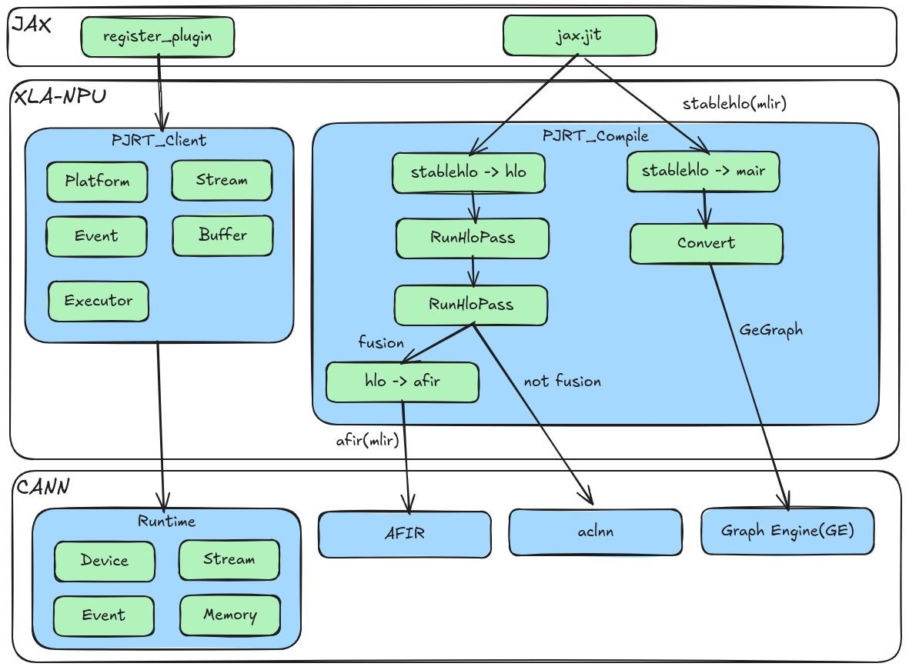

# XLA-NPU（昇腾 NPU 的 XLA 后端）

简体中文 | [English](./README_en.md)

[](https://www.python.org/)
[](https://github.com/google/jax)

## 🔥 最新动态

- [2026/11] 文档更新：参照 CANN 图组件仓库的文档结构梳理 README，补充构建、架构设计、贡献指南与 AI Agent 支持等章节。
- [2026] XLA-NPU 首次开源：实现 OpenXLA PJRT 接口，将昇腾 NPU 接入 XLA/JAX 生态，提供推理场景的整图编译加速能力。

## 🚀 概述

**XLA-NPU** 是一个面向华为昇腾 NPU（Neural Processing Unit）硬件的 **XLA（Accelerated Linear Algebra）后端实现**。项目通过接入 OpenXLA/XLA 开源项目，把 XLA 开源生态与华为 CANN（Compute Architecture for Neural Networks）软件栈集成，并对接 JAX 框架：JAX 运行时直接加载 XLA-NPU 的 PJRT 插件，即可让基于 JAX 开发的模型运行在昇腾 NPU 上，获得推理场景的图编译加速能力。

XLA-NPU 通过实现 OpenXLA PJRT 运行时接口，调用 CANN Runtime 管理设备、Stream、Event、内存等资源驱动 NPU 执行；同时对接 CANN 生态中的 Graph Engine、AFIR/Ascend-MLIR、AutoFuse（Ascend C 自动融合）等编译后端完成图编译。昇腾为基于华为昇腾处理器和软件的行业应用及服务提供全栈 AI 计算基础设施，更多信息请访问[昇腾社区](https://www.hiascend.com/zh/)。



## ⚡️ 快速入门

若希望快速体验 XLA-NPU 的构建与运行流程，可参考以下文档：

- [构建与验证](docs/zh/build.md)：介绍组件依赖、构建、运行环境变量配置与样例验证流程。
- [安装与卸载指南](INSTALL_GUIDE.md)：介绍安装前准备、安装、卸载与常见问题。
- [算子与模型样例](examples/README.md)：以 `ops`、`mmoe`、`qwen` 为例，介绍如何在 CPU 与 NPU 上执行并对比结果。

### 1. 构建 PJRT 插件

```bash
cd /path/to/xla-npu/build
chmod +x build.sh
./build.sh install
```

构建完成后生成 PJRT 插件 `build/code/xla/bazel-bin/xla/xla_npu/pjrt/c/pjrt_c_api_npu_plugin.so` 与运行环境文件 `build/xla_npu_env`。详细参数说明见[构建与验证](docs/zh/build.md)。

### 2. 配置环境变量

```bash
# 配置 CANN 环境变量
source /usr/local/Ascend/cann/set_env.sh

# 加载 XLA-NPU 运行期环境变量
source /path/to/xla-npu/build/xla_npu_env
```

### 3. 在 JAX 中使用 NPU 后端

```python
import os
import jax
import jax.numpy as jnp
import numpy as np

PLATFORM_NAME = 'npu'
LIBRARY_PATH = '/path/to/xla-npu/build/code/xla/bazel-bin/xla/xla_npu/pjrt/c/pjrt_c_api_npu_plugin.so'
os.environ['PJRT_NAMES_AND_LIBRARY_PATHS'] = f"{PLATFORM_NAME}:{LIBRARY_PATH}"
os.environ['JAX_PLATFORMS'] = PLATFORM_NAME

import jax.lib.xla_client

print(f"JAX Default Backend: {jax.default_backend()}")
print(f"Available Devices: {jax.devices()}")

x = np.array([[1.0, 2.0, 3.0, 4.0], [5.0, 6.0, 7.0, 8.0]])
y = jax.jit(lambda x: jnp.tanh(x))(x)
print(f"Result: {y.block_until_ready()}")
```

## 📚 文档

如需了解如何使用 XLA-NPU 进行模型编译与执行，可参见构建指南、特性清单与样例说明：[文档总览](docs/README.md)。

如果希望深入了解 XLA-NPU 的内部设计、架构机制与开发流程，可参考以下文档：

- [架构说明](docs/zh/design/architecture.md)：介绍核心组件、编译执行流程、后端选择与扩展机制等内部原理。
- [贡献指南](CONTRIBUTING.md)：说明如何提交 Issue、Pull Request 以及代码规范。
- [AI Agent 支持](.opencode/README.md)：介绍仓内默认使用的一些 skills 及使用 Agent 辅助开发流程。
- [提交规范](docs/zh/precommit_guide.md)：代码格式、pre-commit 与开源合规检查说明。

## 🌐 生态集成

以下项目与能力已集成 XLA-NPU 作为推理后端：

- **OpenXLA / XLA**：本项目的编译框架基础，`xla_npu/` 以软链方式挂载进 XLA 工作区，不改动 OpenXLA 本体。
- **JAX**：通过 PJRT 插件直接对接，支持 `jax.jit()` 整图编译。
- **CANN**：
  - **Graph Engine（GE）**：作为可选图编译/执行后端（`NPU_AUTO_FUSE_BACKEND=3`）。
  - **AFIR / Ascend-MLIR**：HLO→AFIR→AscIR 自动融合后端（`NPU_AUTO_FUSE_BACKEND=1`）。
  - **AutoFuse（graph-autofusion）**：Ascend C 自动融合与 AscIR 代码生成。
  - **ACLNN / ACL**：逐算子执行与图执行的基础运行接口。

**说明：** 上述列表为已知并对外公开的集成案例，**并非完整清单**。若您正在使用 XLA-NPU，欢迎通过 Issue 或 PR 补充，我们将持续更新相关信息。

## 🖥️ 支持的型号

- Atlas A3 训练系列产品 / Atlas A3 推理系列产品
- Atlas A2 训练系列产品 / Atlas A2 推理系列产品

## 🗂️ 代码与目录结构

```text
xla-npu/
├── .claude/                  # Claude Code 项目配置与说明
├── .gitcode/                 # GitCode Issue / Pull Request 模板
├── .opencode/                # OpenCode 项目配置与 AI Agent 说明
├── build/                    # 构建脚本与构建产物目录
├── docs/                     # 文档目录
├── examples/                 # JAX 算子与模型样例
├── scripts/                  # 开源合规等辅助脚本
├── xla_npu/                  # XLA-NPU 核心实现
├── CMakeLists.txt            # 历史遗留 CMake 入口
├── INSTALL_GUIDE.md          # 安装与卸载指南
├── README.md / README_en.md  # 中英文说明
├── OAT.xml                   # 开源合规配置
└── requirements.txt          # Python 依赖
```

| 目录 / 文件 | 说明 |
| --- | --- |
| `.claude/` | Claude Code 项目级使用说明与约定，详见 [.claude/README.md](.claude/README.md) |
| `.gitcode/` | GitCode 协作模板：Issue 模板、Pull Request 模板与使用说明 |
| `.opencode/` | OpenCode 项目配置（`opencode.jsonc`）与 AI Agent 使用说明 |
| `build/build.sh` | 一键安装/构建/卸载脚本：下载 JDK、Bazel 与 XLA，把 `xla_npu/` 软链进 XLA 工作区，用 Bazel 构建 PJRT 插件，生成 `build/xla_npu_env` |
| `CMakeLists.txt` | 历史遗留的 CMake 入口（顶层脚本指向已不存在的 `xla_npu/mair`，不能直接使用）；GE/AIR 路径的独立调试构建请使用 `xla_npu/pjrt/air/mair/CMakeLists.txt`，正式构建请使用 `build/build.sh` |
| `xla_npu/client/` | PJRT / StreamExecutor 客户端注册：Platform、Compiler、TransferManager、ComputationPlacer |
| `xla_npu/pjrt/c/` | PJRT C API 插件入口（`pjrt_c_api_npu_plugin.so`），按后端开关选择执行路径 |
| `xla_npu/pjrt/npu/` | 基于 StreamExecutor 的 PJRT 客户端实现 |
| `xla_npu/pjrt/plugin/` | 设备、拓扑与设备描述实现 |
| `xla_npu/pjrt/air/` | GE/AIR 后端：`mair` 方言、StableHLO→GE 转换、GE 图执行 |
| `xla_npu/service/` | XLA Service 层：`npu_compiler.cc`（编译入口）、`npu_executable.cc`（thunk 执行与结果交接）、`npu_ir_emitter*`（HLO→thunk）、`npu_hlo_schedule.cc`、`npu_buffer_allocations.cc`、`npu_transfer_manager.cc` 等 |
| `xla_npu/service/transform/` | NPU 专属 HLO pass：`npu_pipeline.cc`（总流水）、`npu_fusion_pipeline.cc`、`npu_priority_fusion.cc`、`npu_copy_fusion.cc`、`npu_dynamic_slice_fusion_rewriter.cc`、`npu_fusion_whitelist.h` |
| `xla_npu/service/convert_to_afir/` | HLO→AFIR→AscIR 自动融合后端：`convert_to_afir.cc`、`ascir_backend.cc`、`hlo_to_afir_tool.cc` |
| `xla_npu/service/kernel/` | 自定义融合 kernel 的配置与编译结果描述 |
| `xla_npu/backend/codegen/` | 融合算子发射（`npu_custom.cc`）与融合接口 |
| `xla_npu/backend/runtime/` | 运行期 thunk：ACLNN thunk、自定义融合 kernel thunk、workspace 内存池与执行流 |
| `xla_npu/stream_executor/` | NPU StreamExecutor 实现：executor / stream / event / platform，以及 AutoFuse kernel 加载与启动 |
| `xla_npu/common/` | 公共设施：环境配置、常量、工具（aclTensor 创建、形状转换）、算子描述 |
| `xla_npu/dependency/interface/` | CANN 运行时接口封装（dlopen）：ACL、ACLNN、opapi |
| `xla_npu/dependency/header/` | CANN 头文件快照（acl / aclnn / GE / metadef） |
| `xla_npu/dependency/external/` | 外部编译依赖的 Bazel 边界：AFIR/Ascend-MLIR |
| `xla_npu/dependency/tool/` | 日志、配置加载、动态函数加载 |
| `xla_npu/dependency/stub/` | GE 相关接口桩，便于无 GE 环境构建/测试 |
| `examples/` | JAX 样例：`ops`（算子/融合）、`mmoe`、`qwen`，支持 CPU/NPU 结果对比 |
| `docs/` | 文档总览、特性与支持清单、构建指南、架构设计、提交规范等 |
| `scripts/oat_check.sh` | 开源合规（OAT）检查脚本 |

## 📝 相关信息

- [安全声明](SECURITY.md)
- [许可证](LICENSE)：Apache License 2.0
- [开源合规配置](OAT.xml)

## 📝 联系我们

- 提交 [Issue](https://gitcode.com/cann/xla-npu/issues)
- 提交 [Pull Request](https://gitcode.com/cann/xla-npu/pulls)

## 🙏 致谢

本项目基于以下开源项目：

- [OpenXLA](https://github.com/openxla/xla) - XLA 编译器框架
- [JAX](https://github.com/google/jax) - 高性能数值计算库
- [StableHLO](https://github.com/openxla/stablehlo) - StableHLO 方言
- [graph-autofusion](https://gitcode.com/cann/graph-autofusion) - 昇腾图自动融合组件
