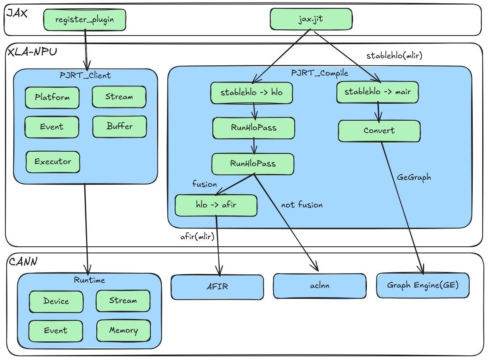

# XLA-NPU (XLA backend for Ascend NPUs)

English | [简体中文](./README.md)

[](https://www.python.org/)
[](https://github.com/google/jax)

## 🔥 Latest News

- [2026/11] Documentation update: restructured the README based on the documentation layout of the CANN graph component repository, and added build, architecture, contribution and AI Agent support sections.
- [2026] First open-source release of XLA-NPU: implements the OpenXLA PJRT interface and brings Ascend NPUs into the XLA/JAX ecosystem for graph-compiled inference.

## 🚀 Overview

**XLA-NPU** is an **XLA (Accelerated Linear Algebra) backend implementation** for Huawei Ascend NPUs. It integrates the OpenXLA/XLA ecosystem with the Huawei CANN (Compute Architecture for Neural Networks) software stack and connects to JAX: the JAX runtime loads the XLA-NPU PJRT plugin directly, so JAX models can run on Ascend NPUs with graph-compilation acceleration for inference.

XLA-NPU implements the OpenXLA PJRT runtime interface and uses the CANN Runtime to manage devices, streams, events and memory. For compilation it integrates CANN Graph Engine, AFIR/Ascend-MLIR and AutoFuse (Ascend C automatic fusion). For more information about Ascend, see the [Ascend community](https://www.hiascend.com/en/).



## ⚡️ Quick Start

- [Build and verify](docs/zh/build.md) (Chinese): dependencies, build, runtime environment variables and example validation.
- [Install and uninstall guide](INSTALL_GUIDE.md) (Chinese): preparation, installation, uninstallation and FAQ.
- [Operator and model examples](examples/README.md) (Chinese): run `ops`, `mmoe` and `qwen` on CPU/NPU and compare results.

### 1. Build the PJRT plugin

```bash
cd /path/to/xla-npu/build
chmod +x build.sh
./build.sh install
```

After the build, the PJRT plugin is generated at `build/code/xla/bazel-bin/xla/xla_npu/pjrt/c/pjrt_c_api_npu_plugin.so`, together with the runtime environment file `build/xla_npu_env`. See [Build and verify](docs/zh/build.md) for details.

### 2. Set up environment variables

```bash
# Set up the CANN environment
source /usr/local/Ascend/cann/set_env.sh

# Load the XLA-NPU runtime environment
source /path/to/xla-npu/build/xla_npu_env
```

### 3. Use the NPU backend in JAX

```python
import os
import jax
import jax.numpy as jnp
import numpy as np

PLATFORM_NAME = 'npu'
LIBRARY_PATH = '/path/to/xla-npu/build/code/xla/bazel-bin/xla/xla_npu/pjrt/c/pjrt_c_api_npu_plugin.so'
os.environ['PJRT_NAMES_AND_LIBRARY_PATHS'] = f"{PLATFORM_NAME}:{LIBRARY_PATH}"
os.environ['JAX_PLATFORMS'] = PLATFORM_NAME

import jax.lib.xla_client

print(f"JAX Default Backend: {jax.default_backend()}")
print(f"Available Devices: {jax.devices()}")

x = np.array([[1.0, 2.0, 3.0, 4.0], [5.0, 6.0, 7.0, 8.0]])
y = jax.jit(lambda x: jnp.tanh(x))(x)
print(f"Result: {y.block_until_ready()}")
```

## 📚 Documentation

To learn how to compile and execute models with XLA-NPU, see the build guide, feature list and examples: [Documentation index](docs/README.md).

To learn more about the internal design, architecture and development process, see:

- [Architecture](docs/zh/design/architecture.md) (Chinese): core components, compilation/execution flow, backend selection and extension mechanisms.
- [Contributing guide](CONTRIBUTING.md): how to submit issues and pull requests, and the code style.
- [AI Agent support](.opencode/README.md) (Chinese): default skills used in this repository and the agent-assisted development workflow.
- [Commit conventions](docs/zh/precommit_guide.md) (Chinese): code formatting, pre-commit and open-source compliance checks.

## 🌐 Ecosystem Integration

The following projects and capabilities integrate XLA-NPU as an inference backend:

- **OpenXLA / XLA**: the compilation framework; `xla_npu/` is symlinked into the XLA workspace without modifying OpenXLA itself.
- **JAX**: integrated through a PJRT plugin, supporting whole-graph `jax.jit()` compilation.
- **CANN**:
  - **Graph Engine (GE)**: optional graph compilation/execution backend (`NPU_AUTO_FUSE_BACKEND=3`).
  - **AFIR / Ascend-MLIR**: HLO→AFIR→AscIR auto-fusion backend (`NPU_AUTO_FUSE_BACKEND=1`).
  - **AutoFuse (graph-autofusion)**: Ascend C automatic fusion and AscIR code generation.
  - **ACLNN / ACL**: per-operator and graph execution runtime interfaces.

**Note:** The list above contains known public integrations and is **not exhaustive**. If you are using XLA-NPU, feel free to add your project via an Issue or Pull Request.

## 🖥️ Supported Products

- Atlas A3 training/inference series
- Atlas A2 training/inference series

## 🗂️ Code and Directory Layout

```text
xla-npu/
├── .claude/                  # Claude Code project configuration and notes
├── .gitcode/                 # GitCode issue / pull request templates
├── .opencode/                # OpenCode project configuration and AI Agent notes
├── build/                    # Build scripts and build artifacts
├── docs/                     # Documentation
├── examples/                 # JAX operator and model examples
├── scripts/                  # Auxiliary scripts such as OAT compliance checks
├── xla_npu/                  # Core XLA-NPU implementation
├── CMakeLists.txt            # Legacy CMake entry
├── INSTALL_GUIDE.md          # Install and uninstall guide
├── README.md / README_en.md  # Chinese and English README
├── OAT.xml                   # Open-source compliance configuration
└── requirements.txt          # Python dependencies
```

| Directory / file | Description |
| --- | --- |
| `.claude/` | Claude Code project-level notes and conventions; see [.claude/README.md](.claude/README.md) |
| `.gitcode/` | GitCode collaboration templates: issue templates, pull request template and usage notes |
| `.opencode/` | OpenCode project configuration (`opencode.jsonc`) and AI Agent notes |
| `build/build.sh` | One-click install/build/uninstall: fetches JDK, Bazel and XLA, symlinks `xla_npu/` into the XLA workspace, builds the PJRT plugin with Bazel and generates `build/xla_npu_env` |
| `CMakeLists.txt` | Legacy CMake entry (the top-level script points to the non-existent `xla_npu/mair` and cannot be used as is); for standalone debugging of the GE/AIR path use `xla_npu/pjrt/air/mair/CMakeLists.txt`, and use `build/build.sh` for the official build |
| `xla_npu/client/` | PJRT / StreamExecutor client registration (platform, compiler, transfer manager, computation placer) |
| `xla_npu/pjrt/c/` | PJRT C API plugin entry (`pjrt_c_api_npu_plugin.so`), selects the execution path by backend |
| `xla_npu/pjrt/npu/` | StreamExecutor-based PJRT client implementation |
| `xla_npu/pjrt/plugin/` | Device, topology and device-description implementations |
| `xla_npu/pjrt/air/` | GE/AIR backend: `mair` dialect, StableHLO→GE conversion, GE graph execution |
| `xla_npu/service/` | XLA service layer: `npu_compiler.cc`, `npu_executable.cc`, `npu_ir_emitter*`, `npu_hlo_schedule.cc`, `npu_buffer_allocations.cc`, `npu_transfer_manager.cc`, etc. |
| `xla_npu/service/transform/` | NPU-specific HLO passes: `npu_pipeline.cc`, `npu_fusion_pipeline.cc`, `npu_priority_fusion.cc`, `npu_copy_fusion.cc`, `npu_dynamic_slice_fusion_rewriter.cc`, `npu_fusion_whitelist.h` |
| `xla_npu/service/convert_to_afir/` | HLO→AFIR→AscIR auto-fusion backend: `convert_to_afir.cc`, `ascir_backend.cc`, `hlo_to_afir_tool.cc` |
| `xla_npu/service/kernel/` | Custom fusion kernel configuration and compile-result description |
| `xla_npu/backend/codegen/` | Fusion emission (`npu_custom.cc`) and fusion interfaces |
| `xla_npu/backend/runtime/` | Runtime thunks: ACLNN thunk, custom fusion kernel thunk, workspace memory pool and execution streams |
| `xla_npu/stream_executor/` | NPU StreamExecutor: executor/stream/event/platform and AutoFuse kernel loading |
| `xla_npu/common/` | Shared utilities: config, constants, aclTensor creation/shape conversion, operation description |
| `xla_npu/dependency/interface/` | dlopen-based wrappers for CANN runtime interfaces (ACL, ACLNN, opapi) |
| `xla_npu/dependency/header/` | Vendored CANN headers (acl / aclnn / GE / metadef) |
| `xla_npu/dependency/external/` | Bazel boundary for external compiler dependencies (AFIR/Ascend-MLIR) |
| `xla_npu/dependency/tool/` | Logging, config loading and dynamic function loading |
| `xla_npu/dependency/stub/` | GE interface stubs for building/testing without a full GE install |
| `examples/` | JAX examples: `ops`, `mmoe`, `qwen`, with CPU/NPU result comparison |
| `docs/` | Documentation index, feature list, build guide, architecture and commit conventions |
| `scripts/oat_check.sh` | Open-source compliance (OAT) check script |

## 📝 Related Information

- [Security statement](SECURITY.md)
- [License](LICENSE): Apache License 2.0
- [Open-source compliance configuration](OAT.xml)

## 📝 Contact Us

- Open an [Issue](https://gitcode.com/cann/xla-npu/issues)
- Open a [Pull Request](https://gitcode.com/cann/xla-npu/pulls)

## 🙏 Acknowledgements

- [OpenXLA](https://github.com/openxla/xla) - XLA compiler framework
- [JAX](https://github.com/google/jax) - high-performance numerical computing library
- [StableHLO](https://github.com/openxla/stablehlo) - StableHLO dialect
- [graph-autofusion](https://gitcode.com/cann/graph-autofusion) - Ascend graph auto-fusion components
