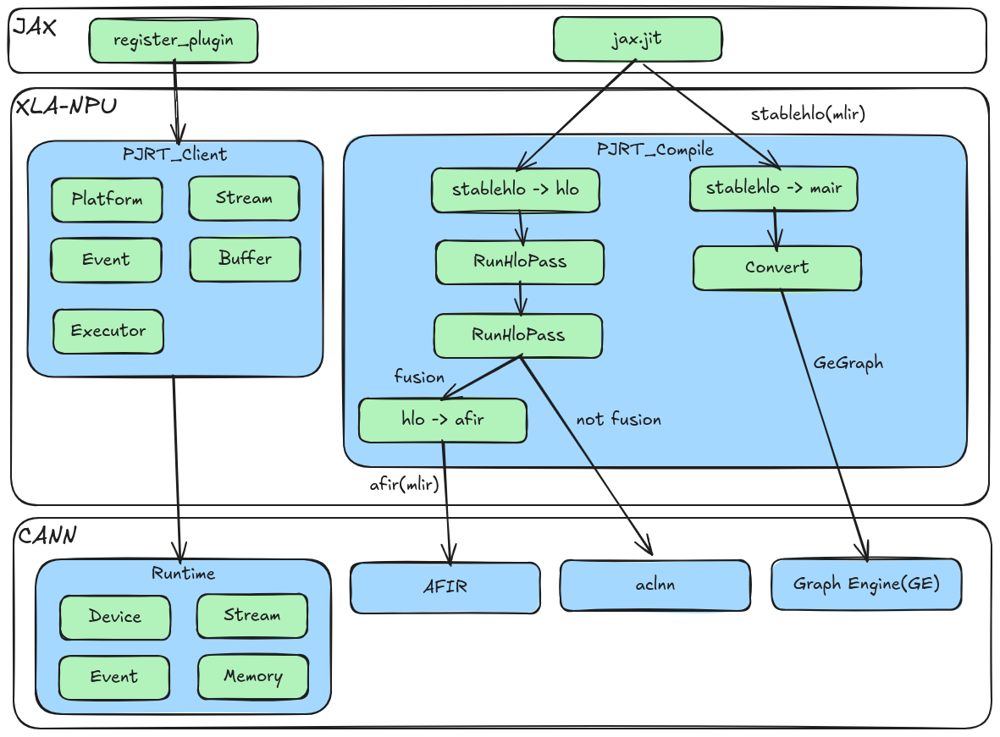

# 简介

## 概述
**XLA-NPU** 是一个面向华为昇腾NPU（Neural Processing Unit）硬件的 **XLA（Accelerated Linear Algebra）后端实现**。本项目通过接入OpenXLA/XLA开源项目，将XLA开源生态与华为 CANN（Compute Architecture for Neural Networks）软件栈集成，对接JAX框架。JAX框架运行时可以直接加载XLA-NPU，使得基于JAX框架开发的模型可以运行在昇腾NPU上，提供推理场景图编译加速能力。

xla\_npu实现OpenXLA PJRT运行时接口，通过调用CANN软件栈中Runtime接口管理设备、Stream、Event、内存等，从而驱动NPU设备运行模型；同时对接CANN生态中Graph Engine、AFIR等编译后端，实现图编译。JAX框架通过加载XLA-NPU动态库so文件，实现JAX框架对接NPU设备，运行JAX脚本及网络。

**图1** XLA-NPU架构图

## 使用说明

-   **使用场景**：当前版本的xla\_npu作为**beta特性**，主要专注于**推理场景**下的模型优化。

-   **产品支持情况**：
    -   Atlas A3 训练系列产品/Atlas A3 推理系列产品
    -   Atlas A2 训练系列产品/Atlas A2 推理系列产品

-   **整体约束**：
    -   当前只支持使用1张NPU卡，不支持集合通信。
    -   只支持`jax.jit()`整图编译。

## 支持的JAX API清单

|JAX API|约束|
|--|--|
|jax.numpy.add|支持fp32|
|jax.numpy.subtract|支持fp32|
|jax.numpy.multiply|支持fp32|
|jax.numpy.divide|支持fp32|
|jax.numpy.tanh|支持fp32|
|jax.numpy.sin|支持fp32|
|jax.numpy.cos|支持fp32|
|jax.numpy.exp|支持fp32|
|jax.lax.rsqrt|支持fp32|
|jax.numpy.negative|支持fp32|
|jax.numpy.maximum|支持fp32|
|jax.numpy.concatenate|支持fp32|
|jax.numpy.transpose|支持fp32|
|jax.lax.slice|支持fp32|
|jax.numpy.max|支持fp32|
|jax.numpy.sum|支持fp32|

> 说明：examples/ops 中还定义了 Dot、Gather、Compare、Select、And 等算子测试用例，因其对应的 HLO opcode 尚未在 NPU 后端实现（见 examples/ops/config.py 中 `_UNSUPPORTED_OPS` 说明），执行时会被跳过，故未列入上表。

## Demo

模型及单个算子用例样例参考[demo](../../examples/README.md)。

## 常见问题
### 使用afir融合后端执行测试用例报错"ModuleNotFoundError: No module named 'runtime'"
**问题原因:**
ASCEND_MLIR_PYTHON_PATH环境变量指向了一个错误或者无效路径
**解决方法:**
执行测试用例前，重新执行`export ASCEND_MLIR_PYTHON_PATH=xla-npu代码仓中dependency下载的Ascend-MLIR中Python可执行文件路径`
