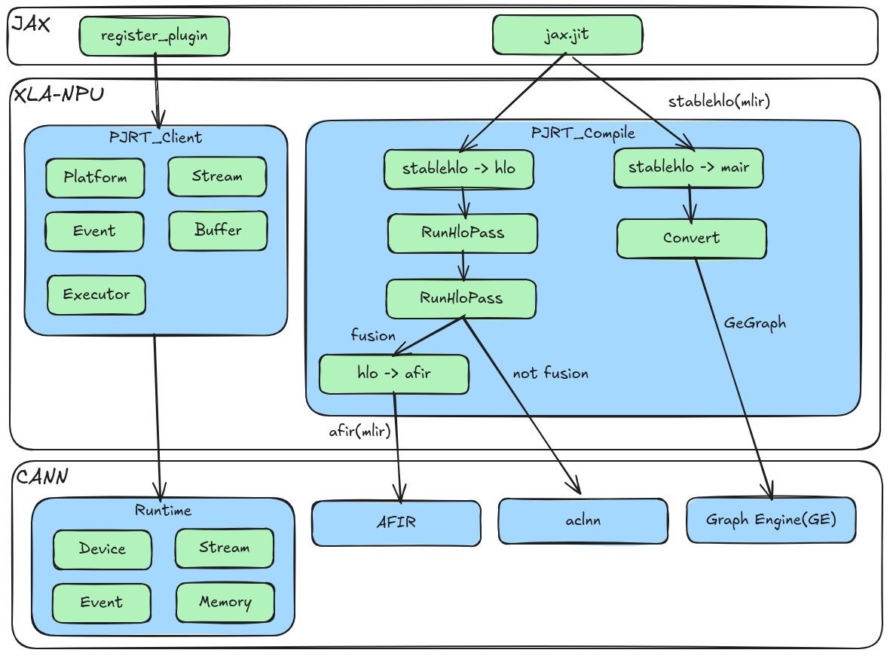

# 架构说明

本文介绍 XLA-NPU 的整体架构、核心组件、编译与执行流程、后端选择机制以及常见扩展点，帮助开发者快速理解内部设计。

## 1. 系统架构总览

XLA-NPU 是 OpenXLA/XLA 的昇腾 NPU 后端，位于 JAX 运行时与 CANN 软件栈之间：

- 向上：以 PJRT 插件形式被 JAX 加载，承接 `jax.jit()` 编译得到的 StableHLO/HLO 计算图。
- 向下：通过 CANN Runtime 管理设备、Stream、Event 与内存，并通过 ACLNN、AFIR/Ascend-MLIR、Graph Engine 等后端完成算子或整图编译与执行。

适用场景与约束：

- 当前版本作为 **beta 特性**，主要面向**推理场景**。
- 仅支持单张 NPU 卡，不支持集合通信。
- 仅支持 `jax.jit()` 整图编译。

## 2. 核心组件

| 层次 | 目录 | 职责 |
| --- | --- | --- |
| PJRT C API | `xla_npu/pjrt/c/` | 导出 `pjrt_c_api_npu_plugin.so`，实现 PJRT C API 并注册插件 |
| PJRT 客户端 | `xla_npu/pjrt/npu/`、`xla_npu/client/` | 基于 StreamExecutor 的 PJRT 客户端、Platform、Compiler、TransferManager 与 ComputationPlacer |
| 设备与拓扑 | `xla_npu/pjrt/plugin/` | 设备描述、拓扑与拓扑描述实现 |
| GE/AIR 路径 | `xla_npu/pjrt/air/` | `mair` 方言、StableHLO→GE 转换、GE 图执行与独立 PJRT 客户端 |
| Service 层 | `xla_npu/service/` | 编译入口、HLO 调度、IR 发射、buffer 分配、可执行对象与结果交接 |
| HLO 优化 | `xla_npu/service/transform/` | NPU 专属 pass 流水：融合、拷贝消除、动态切片、GEMM 交换等 |
| 融合后端 | `xla_npu/service/convert_to_afir/` | HLO→AFIR→AscIR 自动融合 |
| Kernel 描述 | `xla_npu/service/kernel/` | 自定义融合 kernel 配置与编译结果描述 |
| Codegen / Thunk | `xla_npu/backend/codegen/`、`backend/runtime/` | 融合算子发射、ACLNN thunk、自定义 kernel thunk、workspace 内存池 |
| StreamExecutor | `xla_npu/stream_executor/` | NPU executor / stream / event / platform，以及 AutoFuse kernel 加载与启动 |
| 公共设施 | `xla_npu/common/` | 环境配置、常量、aclTensor 与形状转换、算子描述 |
| CANN 依赖 | `xla_npu/dependency/` | ACL/ACLNN/opapi 接口封装、CANN 头文件、外部编译器依赖、GE 桩 |

## 3. 编译与执行流程

一次 `jax.jit()` 调用在 XLA-NPU 中的典型流程如下：

1. **前端编译**：JAX 将 Python 计算图转换为 StableHLO/HLO，并交给 XLA 编译流水。
2. **NPU 专属优化**：XLA 在 HLO 层运行 `xla_npu/service/transform/` 中的 pass，包括融合识别、优先级融合、拷贝融合、动态切片融合、动态 memcpy 改写、GEMM 操作数交换与融合重命名等。
3. **后端编译**：`xla_npu/service/npu_compiler.cc` 根据编译期选择的后端，将 HLO 下发到 ACLNN、AFIR/AscIR 或 GE/AIR。
4. **IR 发射**：`npu_ir_emitter*` 将 HLO 发射为 thunk 序列；`xla_npu/backend/codegen/` 负责融合算子发射。
5. **可执行对象构建**：`npu_executable.cc` 组装 thunk 序列、buffer 分配与执行流分配，得到可执行对象。
6. **运行期执行**：`xla_npu/backend/runtime/` 中的 thunk 通过 `xla_npu/stream_executor/` 提交到 NPU Stream；ACLNN thunk 调用 ACLNN 算子，自定义 kernel thunk 加载并启动自动融合 kernel。
7. **结果交接**：`npu_transfer_manager.cc` 负责 Host/Device 数据传输，PJRT 客户端将结果返回给 JAX。

## 4. 两条 PJRT 执行路径

XLA-NPU 提供两条可选的 PJRT 执行路径：

- **StreamExecutor 路径**：`xla_npu/pjrt/npu/` 基于 XLA StreamExecutor 抽象实现，逐算子或按融合结果提交到 NPU，是默认的通用路径。
- **GE/AIR 路径**：`xla_npu/pjrt/air/` 将 StableHLO 经 `mair` 方言转换为 GE 图，由 Graph Engine 完成整图编译与执行，可通过 `NPU_AUTO_FUSE_BACKEND=3` 选择。

## 5. 后端选择

后端在**构建期**通过 `build/build.sh --npu-auto-fuse-backend=<n>` 选择，并以 Bazel define 形式写入编译宏 `NPU_AUTO_FUSE_BACKEND`：

| 取值 | 后端 | 说明 |
| --- | --- | --- |
| `0` | ACLNN | 不使用融合，逐算子调用 ACLNN |
| `1` | AFIR/AscIR | HLO→AFIR→AscIR 自动融合（默认） |
| `3` | GE/AIR | StableHLO→`mair`→GE 图执行 |

## 6. 融合机制

融合能力主要由以下几部分组成：

- **融合白名单**：`xla_npu/service/transform/npu_fusion_whitelist.h` 定义可融合的算子集合与匹配规则。
- **融合流水**：`npu_fusion_pipeline.cc`、`npu_fusion_dispatch_pipeline.cc` 组织融合 pass 的执行顺序。
- **优先级与拷贝融合**：`npu_priority_fusion.cc`、`npu_copy_fusion.cc` 在保证语义正确的前提下减少中间结果与数据搬运。
- **GEMM 相关改写**：`npu_gemm_fusion_swap_operands.cc` 等 pass 针对矩阵乘场景做布局与操作数调整。
- **自动融合后端**：`xla_npu/service/convert_to_afir/` 将融合体转换为 AscIR，并通过 Ascend-MLIR 生成 Ascend C 代码；`xla_npu/stream_executor/npu_auto_fuse_kernel.*` 负责加载与启动编译产物。

## 7. 内存与执行流

- **Buffer 分配**：`xla_npu/service/npu_buffer_allocations.cc` 负责 HLO buffer 的分配与复用。
- **Workspace 内存池**：`xla_npu/backend/runtime/npu_workspace_memory_pool.*` 管理融合算子运行期临时内存。
- **执行流分配**：`npu_execution_stream_assignment.cc` 将 thunk 映射到 Stream；`npu_latency_hiding_scheduler.cc` 提供延迟隐藏调度能力。

## 8. 扩展点

常见的开发扩展方式如下：

| 扩展目标 | 建议入口 |
| --- | --- |
| 新增 HLO 优化 pass | 在 `xla_npu/service/transform/` 中实现，并在 `npu_pipeline.cc` / `npu_fusion_pipeline.cc` 中注册 |
| 扩展融合算子集合 | 修改 `xla_npu/service/transform/npu_fusion_whitelist.h` |
| 新增 ACLNN 算子映射 | 在 `xla_npu/backend/runtime/npu_aclnn_thunk.cc` 与 `xla_npu/dependency/interface/acl_nn_op_interface.*` 中补充 |
| 接入新的编译后端 | 参考 `xla_npu/service/convert_to_afir/`，并在编译期宏与 `npu_compiler.cc` 中接入 |
| 调整 GE/AIR 图转换 | 修改 `xla_npu/pjrt/air/mair/` 下的方言定义与转换逻辑 |

更完整的目录说明见根目录 [README.md](../../../README.md) 的「代码与目录结构」章节，开发流程与规范见 [贡献指南](../../../CONTRIBUTING.md)。
